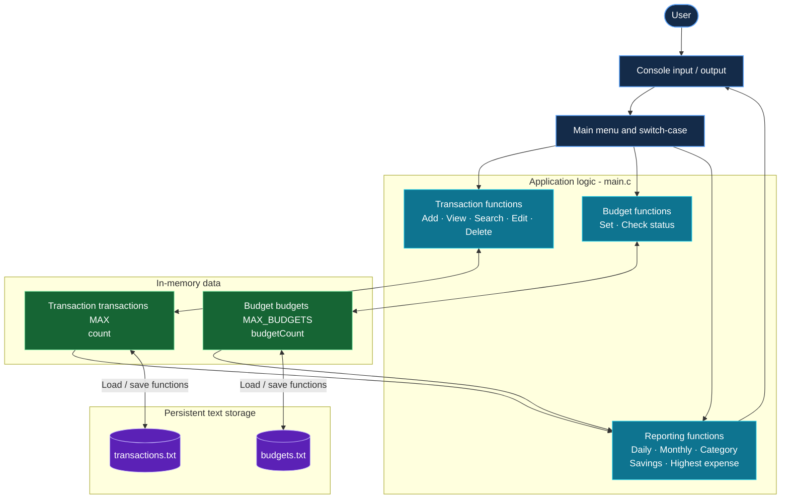

<div align="center">

# Personal Expense Tracker

**A modular, console-based financial management application written in C**

Track income and expenses · Monitor monthly budgets · Understand spending patterns


[Features](#features) · [Architecture](#system-architecture) · [Getting Started](#getting-started) · [Presentation](#project-presentation)

</div>

---

## Overview

**Personal Expense Tracker** is a single-file C application that helps users record income and expenses, set monthly budgets, and review financial activity. It demonstrates practical use of **structures, arrays, functions, pointers, input validation, and text-file handling** without a database or graphical interface.

### Project goals

- Keep financial records organized in a simple terminal interface.
- Provide useful daily, monthly, and category-based spending insights.
- Preserve transactions and budgets across program restarts.
- Write readable, reusable C functions with explicit parameters.

## Features

| Area | Capabilities |
|:--|:--|
| **Transactions** | Add income or expenses; view, search, edit, and delete records |
| **Reports** | Daily report, monthly report, category-wise analysis, day-wise monthly breakdown |
| **Budgets** | Set monthly limits and check spending against the budget |
| **Insights** | Highest expense and overall savings summary |
| **Storage** | Load and save records in plain `.txt` files |
| **Reliability** | Date, amount, and menu input validation; unique transaction IDs |

## System Architecture

The project is organized into **logical modules within one `main.c` file**. The diagram shows how user commands reach functions, how records are held in memory, and how text files preserve them.



**Execution flow:** On startup, saved records are loaded into arrays. The user chooses an operation from the menu. The corresponding function receives the relevant arrays and counters through parameters. Changes are saved to text files; reports calculate results from the in-memory records and print them to the console.

## Project Structure

```text
Personal-Expense-Tracker/
├── main.c                         # Complete C application
├── README.md                      # Project documentation
├── presentation/
│   └── Personal_Expense_Tracker_Complete_Explained.pptx
├── transactions.txt               # Created when transactions are saved
└── budgets.txt                    # Created when budgets are saved
```

> **Privacy:** Do not commit real financial records. Keep `transactions.txt` and `budgets.txt` out of your public repository.

## Getting Started

### Requirements

- A C11-compatible compiler, such as GCC
- A terminal (VS Code's integrated terminal works)

### Compile and run

**Windows (PowerShell):**

```powershell
gcc -std=c11 -Wall -Wextra main.c -o tracker.exe
.\tracker.exe
```

**Linux / macOS:**

```bash
gcc -std=c11 -Wall -Wextra main.c -o tracker
./tracker
```

The application reads and writes text files in the **current working directory**. Run it from the project folder to keep the data files together.

## Console Menu

```text
================ PERSONAL EXPENSE TRACKER ================
  1. Add Income                 8. Edit Transaction
  2. Add Expense                9. Delete Transaction
  3. View All Transactions     10. Set Monthly Budget
  4. Daily Report              11. Check Budget Status
  5. Monthly Report            12. Highest Expense
  6. Category-wise Analysis    13. Savings Summary
  7. Search Transactions       14. Day-wise Monthly Breakdown

  0. Exit
==========================================================
Choose an option:
```

*Menu shown in a condensed format for documentation; terminal spacing may differ.*

## Data Model

The application defines two structures:

```c
typedef struct
{
    int id;
    int type;       /* 1 = income, 2 = expense */
    int day;
    int month;
    int year;
    double amount;
    char category[30];
    char note[80];
} Transaction;

typedef struct
{
    int month;
    int year;
    double limit;
} Budget;
```

`Transaction` stores each income or expense record. `Budget` stores a spending limit for a particular month and year. Their arrays are created in `main()` and passed to functions as needed.

### Why `count` and `&count`?

```c
viewTransactions(transactions, count);
addTransaction(transactions, &count, 2);
```

- **`count`** passes the number of valid records when a function only needs to read it.
- **`&count`** passes its address when a function must update the original record count.
- The transaction array is passed to both functions, so they operate on the same stored records.

## File Handling

| File | Purpose | Format |
|:--|:--|:--|
| `transactions.txt` | Income and expense records | Pipe-separated text fields |
| `budgets.txt` | Monthly budget records | Pipe-separated text fields |

The implementation uses standard C text-file operations such as `fopen`, `fgets`, `sscanf`, `fprintf`, and `fclose`. Files are loaded at startup and rewritten after successful record changes.

## Reporting Logic

- **Daily report:** Filters transactions by a selected date and totals income and expenses.
- **Monthly report:** Filters by month and year and calculates financial totals.
- **Category analysis:** Groups expense amounts by category.
- **Day-wise breakdown:** Summarizes activity for each day of a selected month.
- **Savings summary:** Calculates **total income − total expenses**.
- **Budget status:** Compares expenses for a month against its configured limit.

### Example (illustrative)

| Metric | Amount |
|:--|--:|
| Monthly income | Rs. 10,000 |
| Food expenses | Rs. 1,500 |
| Travel expenses | Rs. 500 |
| Total expenses | Rs. 2,000 |
| Remaining balance | **Rs. 8,000** |

## Design Decisions

- **Single source file:** Easy to compile and demonstrate for an academic project.
- **Reusable functions:** Income and expenses share transaction-handling logic.
- **Explicit parameters:** Data flows between functions without global transaction arrays.
- **In-memory arrays:** Reports can process records without reopening files each time.
- **Plain-text persistence:** Easy to inspect and understand using introductory C file handling.

### Current limitations

The application is single-user and console-based, stores up to **1,000 transactions** and **120 budget records**, and uses text files rather than a database. A linear search through `n` transactions takes **O(n)** time; saving all records also requires **O(n)** work.

## Project Presentation

The complete 20-slide presentation walks through the project objectives, system architecture, structures, arrays, function calls, pointers, transaction operations, TXT file handling, daily and monthly reports, budgets, code efficiency, a live demonstration, and viva questions.

**[Open the project presentation](presentation/Personal_Expense_Tracker_Complete_Explained.pptx)**

> ## 📊 Project Presentation & Documentation

Explore the complete Personal Expense Tracker project through its detailed presentation and documentation.

The presentation covers system architecture, C programming concepts, structures, functions, pointers, TXT file handling, expense analysis, and budget management.
## 📊 Project Presentation

Explore the complete Personal Expense Tracker project through a detailed PDF presentation.

The presentation covers:
- Project overview and objectives
- System architecture
- Structures and arrays
- Functions and parameter passing
- Pointers and memory management
- TXT file handling
- Daily and monthly expense analysis
- Budget management
- Code efficiency and future improvements

### 📄 [View Complete Project Presentation (PDF)](presentation/Personal_Expense_Tracker_Complete_Explained.pdf)
## Future Scope

Possible improvements include a graphical interface, database-backed storage, recurring transactions, user accounts, and richer visual analytics. These are **not included** in the current version.

## Author

**Mayank Chamoli**  
B.Tech — Computer Science Engineering  
[GitHub Profile](https://github.com/mayankchamoli42007-dev)

---

<div align="center">

**Built with C to turn core programming concepts into a practical finance tool.**

</div>
